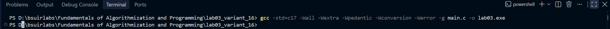
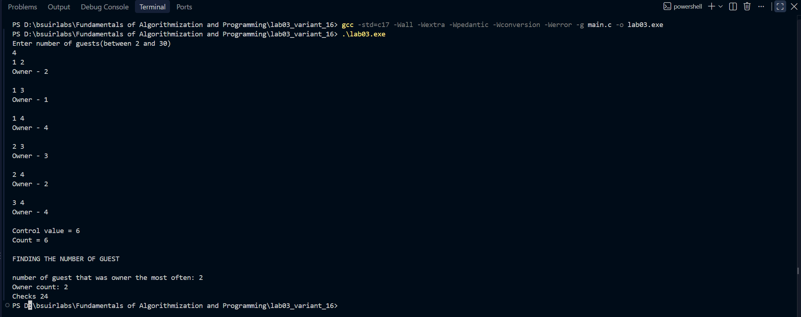
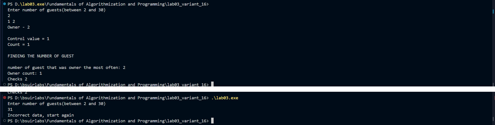

# lab03_variant_16
# Лабораторная работа № 3. Вложенные циклы и полный перебор

**ФИО:** Каскевич Кирилл Артемович  
**Группа:** 651002  
**Вариант:** 16 — «Круговой турнир»  
**Репозиторий:** [lab03_variant_16](https://github.com/skipperooooh/lab03_variant_16)

## 1. Постановка задачи

Для `N` участников вывести список встреч, в котором каждая пара играет ровно один раз. В паре `(i, j)`, где `i < j`, хозяин — `i`, если `i + j` чётно, иначе `j`. После списка встреч вывести фактическое количество встреч и контрольное значение `N * (N - 1) / 2`. Затем определить участника, которого чаще остальных назначали хозяином; при равенстве выбрать меньший номер.

| Что | Значение |
|---|---|
| Входные данные | целое `N` — количество участников |
| Ограничение | `2 <= N <= 30` |
| Изменяемые параметры перебора | `i`, `j` (пары встреч), `k` (кандидат на звание «самого частого хозяина») |
| Результаты | список встреч с хозяевами; `Control value`; `Count`; номер участника и число его назначений |
| Ожидаемое число встреч | `N * (N - 1) / 2` |

## 2. Алгоритм в `main.c`

1. Программа читает `N`. Если `scanf` не прочитал целое число либо `N < 2` или `N > 30`, печатается `Incorrect data, start again`, после чего программа завершается с кодом `1` до перебора.
2. **Перечисление встреч.** Циклы `i` и `j` рассматривают пары при `1 <= i < j <= N`. Для каждой пары печатаются участники и хозяин: `i`, если сумма чётная, иначе `j`. После этого увеличивается `count`.
3. Печатаются контрольное значение `N * (N - 1) / 2` и фактический `count`.
4. **Базовый поиск самого частого хозяина.** Для каждого кандидата `k` от 1 до `N` обнуляется `owner_count`, затем циклы `i` и `j` повторно перебирают все пары. `checks` увеличивается при каждом входе в тело внутреннего цикла. Если пара не содержит `k`, увеличивается `skipped` и выполняется `continue`. Для пары с `k` проверяется правило чётности и увеличивается `owner_count`, если хозяин — `k`.
5. После проверки всех пар для текущего `k` значение `owner_count` сравнивается с `max_owner_count`. При строгом `>` сохраняются максимум и номер участника. Кандидаты идут по возрастанию, поэтому при равенстве остаётся меньший номер.
6. **Сокращённый поиск (уровень 9).** Для каждого `k` отдельно проверяются партнёры `m < k` и `m > k`. В первом случае пара имеет вид `(m, k)`, и `k` является хозяином при нечётной сумме. Во втором пара имеет вид `(k, m)`, и `k` является хозяином при чётной сумме. `checks2` считает проверенных партнёров. Обновление максимума выполняется тем же строгим сравнением `>`.
7. Печатаются результаты базового и сокращённого поиска, а также счётчики `Checks`, `Skipped` и `Checks2`.

Массивы, строки для хранения данных, структуры, динамическая память, рекурсия и пользовательские функции не используются. Для каждого поиска хранятся только текущий счётчик кандидата, текущий максимум и номер участника с этим максимумом.

## 3. Циклы и счётчики

| Цикл | Уровень | Что перебирает | Инициализация | Условие | Изменение |
|---|---|---|---|---|---|
| `i` (проход 1) | внешний | первого участника пары | `i = 1` | `i <= N` | `++i` |
| `j` (проход 1) | внутренний | второго участника пары | `j = i + 1` | `j <= N` | `++j` |
| `k` (базовый поиск) | внешний | кандидата в «самые частые хозяева» | `k = 1` | `k <= N` | `++k` |
| `i` (базовый поиск) | средний | первого участника пары | `i = 1` | `i <= N` | `++i` |
| `j` (базовый поиск) | внутренний | второго участника пары | `j = i + 1` | `j <= N` | `++j` |
| `k` (сокращённый поиск) | внешний | кандидата | `k = 1` | `k <= N` | `++k` |
| `m` (первый цикл партнёров) | внутренний | участников меньше `k` | `m = 1` | `m < k` | `++m` |
| `m` (второй цикл партнёров) | внутренний | участников больше `k` | `m = k + 1` | `m <= N` | `++m` |

| Переменная | Начальное значение | Когда меняется |
|---|---|---|
| `count` | `0` | `count++` после каждой выведенной встречи |
| `owner_count` | `0` в начале каждого `k` | `+1`, если хозяин пары равен `k` |
| `max_owner_count` | `0` | при `owner_count > max_owner_count` |
| `most_frequent_owner` | `0` | вместе с `max_owner_count` равно текущему `k` |
| `checks` | `0` до базового поиска | при каждом выполнении тела цикла `j` |
| `skipped` | `0` до базового поиска | если пара не содержит текущего `k` |
| `checks2` | `0` до сокращённого поиска | при проверке каждого партнёра `m` |
| `owner_count2` | `0` в начале каждого `k` сокращённого поиска | если правило чётности назначает хозяином `k` |
| `max_owner_count2` | `0` | при `owner_count2 > max_owner_count2` |
| `most_frequent_owner2` | `0` | вместе с `max_owner_count2` равно текущему `k` |

**Почему циклы завершаются.** Каждый счётчик увеличивается на 1 на каждом шаге и сравнивается с конечной границей `N`, а `N` не превышает 30. Поэтому условие рано или поздно становится ложным.

**Почему нет повторов.** Внутренний цикл начинается с `j = i + 1`. Пара `(j, i)` и пара участника с самим собой не возникают. Число пар получается `(N - 1) + (N - 2) + ... + 1 = N * (N - 1) / 2`.

**Объём работы.** Перечисление встреч выполняет `N * (N - 1) / 2` итераций. Базовый поиск выполняет `N * N * (N - 1) / 2` итераций внутреннего цикла: при `N = 4` это 24, при `N = 30` — 13050. Среди них `skipped = N * (N - 1) * (N - 2) / 2` пар-кандидатов не содержат `k`. Сокращённый поиск проверяет `N - 1` партнёров для каждого из `N` кандидатов, всего `checks2 = N * (N - 1)`: 12 при `N = 4` и 870 при `N = 30`. Для `N = 2` оба поиска выполняют по 2 проверки; при увеличении `N` сокращённый перебор проверяет меньше пар.

## 4. Блок-схема

Схема разделена на две части: перечисление встреч и поиск участника с наибольшим числом назначений.

- Исходник: [flowchart.drawio](flowchart.drawio)
- Экспорт: [evidence/flowchart.png](evidence/flowchart.png)


**Соответствие схемы программе.**

| Блок схемы | Код в `main.c` |
|---|---|
| Ввести `N`; ромб проверки входа | `scanf("%d", &N)` и условие `if (scanf(...) != 1 \|\| N < 2 \|\| N > 30)`; ветка «нет» — сообщение и `return 1` |
| `count = 0; max_owner_count = 0; most_frequent_owner = 0` | объявления с инициализацией |
| `i = 1`, `i <= N?`, `i = i + 1`; `j = i + 1`, `j <= N?`, `j = j + 1` | вложенные циклы `for` первого прохода |
| Вывод пары, ромб `(i + j) % 2 == 0?`, вывод хозяина `i` или `j` | `printf`, `if / else` |
| `count = count + 1` | `count++` |
| Вывод `N*(N-1)/2` и `count` | два `printf` после первого прохода |
| `k = 1`, `k <= N?`, `k = k + 1` | внешний цикл `for (int k ...)` второго прохода |
| `owner_count = 0; i = 1` | начало тела цикла по `k` |
| Ромбы `i == k?` и `j == k?` | вложенные `if` в ветках чётности |
| Ромб `owner_count > max_owner_count?` и блок присваивания | сравнение и обновление максимума после циклов `i`, `j` |

## 5. Сборка и запуск

Из каталога лабораторной (Windows, PowerShell):

```powershell
gcc -std=c17 -Wall -Wextra -Wpedantic -Wconversion -g main.c -o lab03.exe
.\lab03.exe
```

Сборка проходит без предупреждений (см. `evidence/build.png`).

## 6. Тесты

Ожидаемые значения рассчитаны заранее по формуле `N * (N - 1) / 2` и ручному подсчёту хозяев. Фактические значения получены запуском `lab03.exe`.

| № | Группа | Ввод | Ожидаемый результат | Фактический результат | Вывод |
|--:|---|---|---|---|---|
| 1 | Малый трассировочный | `4` | 6 встреч; №2 и №4 по 2 назначения; итог №2 / 2 | 6 встреч; `Control value = 6`, `Count = 6`; итог №2 / 2 | Совпало |
| 2 | Малый | `3` | 3 встречи; у всех по 1; итог №1 / 1 | 3 встречи; `Control value = 3`, `Count = 3`; итог №1 / 1 | Совпало |
| 3 | Обычный | `5` | 10 встреч; у всех по 2; итог №1 / 2 | 10 встреч; `Control value = 10`, `Count = 10`; итог №1 / 2 | Совпало |
| 4 | Обычный | `6` | 15 встреч; №2, №4, №6 по 3; итог №2 / 3 | 15 встреч; `Control value = 15`, `Count = 15`; итог №2 / 3 | Совпало |
| 5 | Граница (минимум) | `2` | 1 встреча `1 2`, хозяин №2; итог №2 / 1 | `1 2`, `Owner - 2`; `Control value = 1`, `Count = 1`; итог №2 / 1 | Совпало |
| 6 | Граница (максимум) | `30` | 435 встреч; итог №2 / 15 | `Control value = 435`, `Count = 435`; итог №2 / 15 | Совпало |
| 7 | Защита от повторов | `6` | 15 различных пар, везде `i < j` | 15 пар от `1 2` до `5 6`; пар `(j, i)` и `(i, i)` нет | Совпало |
| 8 | Некорректный ввод | `1` | `Incorrect data, start again` | `Incorrect data, start again` | Совпало |
| 9 | Некорректный ввод | `31` | `Incorrect data, start again` | `Incorrect data, start again` | Совпало |
| 10 | Некорректный ввод | `abc` | `Incorrect data, start again` | `Incorrect data, start again` | Совпало |
| 11 | Некорректный ввод | EOF (Ctrl+Z) | `Incorrect data, start again` | `Incorrect data, start again` | Совпало |
| 12 | Нет решения | — | Невозможен: при `N >= 2` всегда есть пара | — | Для варианта 16 не применимо |

В тестах 8–11 перебор встреч не начинался: программа сразу завершалась после сообщения. Это подтверждает, что вход проверяется до основного вычисления.

**Ограничение ввода.** `scanf("%d")` читает целое число и оставляет хвост строки. Ввод вида `5.5` или `12abc` будет принят как `5` и `12`.

## 7. Трассировка малого контрольного примера (`N = 4`)

**Первый проход:**

| `i` | `j` | `i + j` | Хозяин | `count` после встречи |
|---:|---:|---:|---:|---:|
| 1 | 2 | 3 | 2 | 1 |
| 1 | 3 | 4 | 1 | 2 |
| 1 | 4 | 5 | 4 | 3 |
| 2 | 3 | 5 | 3 | 4 |
| 2 | 4 | 6 | 2 | 5 |
| 3 | 4 | 7 | 4 | 6 |

Итого `count = 6`, что совпадает с `4 * 3 / 2 = 6`.

**Второй проход (поиск участника):**

| `k` | `owner_count` | `owner_count > max_owner_count?` | `max_owner_count` | `most_frequent_owner` |
|---:|---:|---|---:|---:|
| 1 | 1 | да (1 > 0) | 1 | 1 |
| 2 | 2 | да (2 > 1) | 2 | 2 |
| 3 | 1 | нет (1 > 2 ложно) | 2 | 2 |
| 4 | 2 | нет (2 > 2 ложно) | 2 | 2 |

Участник №4 не заменяет №2, потому что сравнение строгое. Результат: участник №2, 2 назначения.

## 8. Подтверждения

**Сборка** (`evidence/build.png`):



**Контрольный запуск, `N = 4`** (`evidence/control_run.png`):



**Граничный запуск, `N = 2`** (`evidence/boundary_run.png`):



## 9. Работа с AI

Запрос к AI, его ответ и проверка замечаний записаны в [ai_protocol.md](ai_protocol.md). Готовый код у AI не запрашивался.

Итог проверки:

- Замечания о границах пар, равенстве максимумов и нижней границе `N = 2` подтверждены запуском и ручной трассировкой (тесты 1, 5, 7).
- Предложение объединить подсчёт частот с первым проходом отклонено: для этого нужен массив частот или отдельный счётчик на каждого из 30 участников, а массивы в работе запрещены.
- Замечание о проверке результата `scanf` разобрано в `ai_protocol.md`. В итоговом `main.c` проверка присутствует (`scanf(...) != 1`) и подтверждена тестами 10 и 11.

## 10. Уровневые задания

### Уровень 7. Трассировка вложенных циклов

В базовом поиске добавлен счётчик `checks`. Он увеличивается один раз при каждом выполнении тела самого внутреннего цикла `j`, до проверки `continue`. Поэтому `checks` учитывает все пары для каждого кандидата `k`, включая пары, которые далее пропускаются.

Для одного кандидата перебирается `N * (N - 1) / 2` пар. Кандидатов `N`, поэтому общее число итераций:

`checks = N * N * (N - 1) / 2`.

**Трассировка для `N = 4`:**

| `k` | Пар за этот `k` | `checks` после этого `k` |
|---:|---:|---:|
| 1 | 6 | 6 |
| 2 | 6 | 12 |
| 3 | 6 | 18 |
| 4 | 6 | 24 |

Итого `checks = 24`. Это число итераций поиска, а не количество встреч: в первом проходе встреч 6.

| `N` | Расчёт | Ожидаемое `Checks` |
|--:|---|--:|
| 2 | `2 * 2 * 1 / 2` | 2 |
| 4 | `4 * 4 * 3 / 2` | 24 |
| 6 | `6 * 6 * 5 / 2` | 90 |
| 30 | `30 * 30 * 29 / 2` | 13050 |

В `main.c` счётчик объявлен как `int checks = 0;`, поэтому подсчёт начинается с нуля.

### Уровень 8. Управление выполнением

В теле внутреннего цикла `j` базового поиска используется `continue`. Если ни `i`, ни `j` не равны текущему кандидату `k`, эта пара не может увеличить число его назначений хозяином. Программа увеличивает `skipped` и переходит к следующей итерации именно цикла `j`. Циклы `i` и `k` продолжаются.

`checks` увеличивается до проверки `continue`, поэтому продолжает учитывать все итерации. Для каждого `k` есть `N - 1` пар с этим участником. Пары без `k` составляют `N * (N - 1) / 2 - (N - 1)`, а всего:

`skipped = N * (N - 1) * (N - 2) / 2`.

| Случай | `N` | Ожидаемое `Checks` | Ожидаемое `Skipped` | Проверяемое свойство |
|---|--:|--:|--:|---|
| `continue` срабатывает | 4 | 24 | 12 | Для каждого `k` три из шести пар его не содержат |
| `continue` не срабатывает | 2 | 2 | 0 | Единственная пара содержит обоих участников |
| Больше пар пропускается | 6 | 90 | 60 | Для каждого `k` пять из пятнадцати пар его не содержат |

Значения в этой таблице рассчитаны по границам циклов. При контрольном запуске их следует сверить с выводом программы.

### Уровень 9. Сокращение перебора

В базовом поиске для каждого кандидата `k` перебираются все пары. Сокращённый поиск проверяет только пары с `k`:

- При `m < k` рассматривается пара `(m, k)`. Кандидат `k` стоит на втором месте и является хозяином при нечётной сумме.
- При `m > k` рассматривается пара `(k, m)`. Кандидат `k` стоит на первом месте и является хозяином при чётной сумме.

Пара без `k` не может увеличить его `owner_count`, потому что хозяином всегда является один из участников этой пары. Каждая пара с `k` попадает ровно в один из двух циклов: её партнёр либо меньше `k`, либо больше `k`. Правило выбора хозяина и порядок кандидатов не меняются. Поэтому число назначений каждого участника и выбор меньшего номера при равенстве сохраняются.

Базовый алгоритм выполняет `N * N * (N - 1) / 2` итераций. Сокращённый перебирает `N - 1` партнёров для каждого из `N` кандидатов: `N * (N - 1)` проверок.

**Три контрольных сравнения по расчёту:**

| `N` | Результат базового поиска | Результат сокращённого поиска | `Checks` | `Checks2` | Сверка |
|--:|---|---|--:|--:|---|
| 2 | №2, 1 назначение | №2, 1 назначение | 2 | 2 | Результаты совпадают |
| 4 | №2, 2 назначения | №2, 2 назначения | 24 | 12 | Результаты совпадают; проверок вдвое меньше |
| 6 | №2, 3 назначения | №2, 3 назначения | 90 | 30 | Результаты совпадают; проверок втрое меньше |

Числа в таблице получены ручным расчётом по циклам. После запуска текущей версии их нужно сверить с напечатанными `Checks` и `Checks2`.
### Уровень 10. Экспериментальное сравнение

Оба исходных файла были скомпилированы и запущены для одинаковых значений `N`. В базовой версии записан счётчик `Checks` из `main.c`. Для улучшенной версии взят счётчик `Checks2` из блока `Improved algorithm` в `analysis.c`. Совпадение проверялось по номеру участника с наибольшим числом назначений хозяином и по самому числу назначений.

| N | Базовый результат (участник / назначения) | Улучшенный результат (участник / назначения) | Результаты совпали | Базовые итерации (`Checks`) | Улучшенные итерации (`Checks2`) |
|---:|:---:|:---:|:---:|---:|---:|
| 2 | 2 / 1 | 2 / 1 | Да | 2 | 2 |
| 3 | 1 / 1 | 1 / 1 | Да | 9 | 6 |
| 4 | 2 / 2 | 2 / 2 | Да | 24 | 12 |
| 5 | 1 / 2 | 1 / 2 | Да | 50 | 20 |
| 6 | 2 / 3 | 2 / 3 | Да | 90 | 30 |
| 8 | 2 / 4 | 2 / 4 | Да | 224 | 56 |
| 10 | 2 / 5 | 2 / 5 | Да | 450 | 90 |
| 15 | 1 / 7 | 1 / 7 | Да | 1 575 | 210 |
| 20 | 2 / 10 | 2 / 10 | Да | 3 800 | 380 |
| 30 | 2 / 15 | 2 / 15 | Да | 13 050 | 870 |

Во всех десяти запусках найденные результаты совпали. При `N = 2` число проверок одинаково: единственная пара содержит обоих участников. При увеличении `N` сокращённый алгоритм выполняет значительно меньше итераций.


## 11. Итоговый вывод

В программе реализованы базовая часть и уровни 7–9. Первый проход перечисляет пары `i < j` и назначает хозяина по чётности суммы. Базовый поиск проверяет все пары для каждого кандидата и с помощью `continue` пропускает дальнейшую обработку пар без этого кандидата. Сокращённый поиск рассматривает только пары, в которых участвует кандидат.

Для `N = 4` базовый поиск выполняет 24 итерации, сокращённый — 12; по ручному расчёту оба выбирают участника №2 с двумя назначениями. В общем случае счётчики равны `N * N * (N - 1) / 2` и `N * (N - 1)` соответственно. При `N <= 30` оба алгоритма завершаются за конечное число итераций. 
